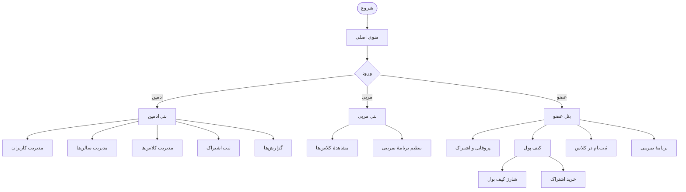

# سامانهٔ مدیریت باشگاه ورزشی

پروژهٔ پایانی بوت‌کمپ — سیستم مدیریت باشگاه ورزشی با معماری لایه‌ای و ذخیره‌سازی در فایل‌های JSON.

## امکانات

### پنل ادمین
- مدیریت کاربران (افزودن، ویرایش، فعال/غیرفعال‌سازی)
- مدیریت سالن‌ها و کلاس‌ها
- ثبت اشتراک برای اعضا
- گزارش‌های مالی و وضعیت اشتراک‌ها
- خروجی گرفتن از لیست کاربران در فایل متنی

### پنل مربی
- مشاهدهٔ کلاس‌های خود
- تنظیم برنامهٔ تمرینی برای اعضای هر کلاس

### پنل عضو
- مشاهدهٔ پروفایل و وضعیت اشتراک
- مدیریت کیف پول (شارژ، مشاهدهٔ موجودی، تاریخچهٔ تراکنش‌ها)
- خرید و تمدید اشتراک
- ثبت‌نام و لغو ثبت‌نام در کلاس‌ها
- مشاهدهٔ برنامهٔ تمرینی شخصی

## جریان برنامه



## ساختار پروژه

```text
project/
├── main.py
├── Bank.py
├── core/
│   ├── models.py
│   ├── storage.py
│   ├── exceptions.py
│   └── back.py
├── Repositories/
│   ├── base_repository.py
│   ├── users_repository.py
│   ├── classes_repository.py
│   ├── halls_repository.py
│   ├── wallet_repository.py
│   ├── subscriptions_repository.py
│   ├── transactions_repository.py
│   ├── sabtenam_repository.py
│   └── exercise_plan_repository.py
├── services/
│   ├── adminServices.py
│   ├── coach_services.py
│   ├── member_services.py
│   ├── wallet_services.py
│   ├── validation.py
│   └── reports.py
├── panels/
│   └── menus.py
└── data/
```

## نحوهٔ اجرا

```bash
python main.py
```

نیازمند Python 3.7 یا بالاتر. هیچ کتابخانهٔ خارجی لازم نیست.

## اطلاعات ورود پیش‌فرض

| نقش | نام کاربری | رمز عبور |
|------|-------------|-----------|
| ادمین | `admin` | `admin135@` |
| مربی | `reza_3451&` | `ReZaORD#4` |
| عضو | `kobraf` | `password1&` |

## معماری

پروژه از معماری لایه‌ای استفاده می‌کند:

- **Models:** نمایش داده‌ها به‌صورت شیء. هر کلاس متدهای `to_dict` و `from_dict` دارد. ساخت مستقیم شیء با `__init__` ممنوع است و فقط از طریق `from_dict` انجام می‌شود (الگوی `_ALLOW_INIT`).
- **Repositories:** لایهٔ میانی بین منطق و ذخیره‌سازی. کلاس پایه `base_repository` عملیات مشترک (add, update, delete, ...) را فراهم می‌کند و هر repository اختصاصی، متدهای جستجو را اضافه می‌کند.
- **Services:** منطق کسب‌وکار. هر پنل یک فایل سرویس جداگانه دارد.
- **Panels:** رابط کاربری مبتنی بر منوهای متنی.

## ذخیره‌سازی

داده‌ها در فایل‌های JSON زیر پوشهٔ `data/` ذخیره می‌شوند:

- `users.json` — کاربران
- `wallets.json` — کیف پول اعضا
- `salons.json` — سالن‌ها
- `sport_classes.json` — کلاس‌ها
- `subscriptions.json` — اشتراک‌ها
- `sabtenam.json` — ثبت‌نام‌ها
- `exercise_plan.json` — برنامه‌های تمرینی
- `transactions.json` — تراکنش‌های مالی
- `subscription_plans.json` — پلن‌های اشتراک

## اعضای تیم

- رضا عباس زاده
- عارفه بهرامیان
- سیروس سرمستی
- مبینا جنیدی